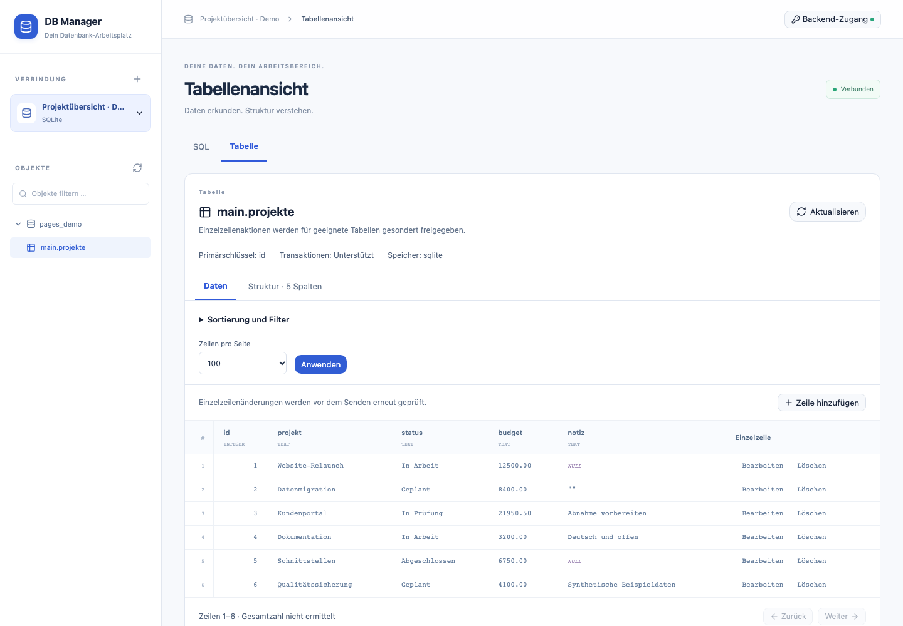
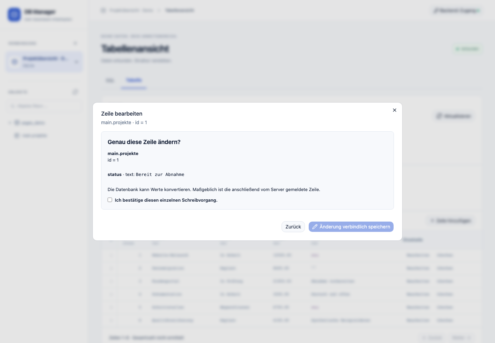
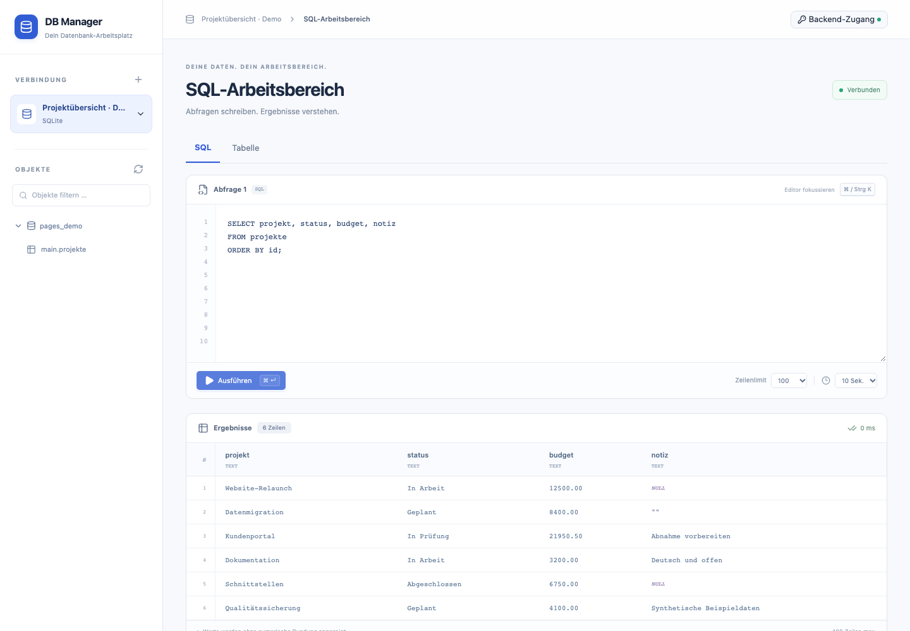
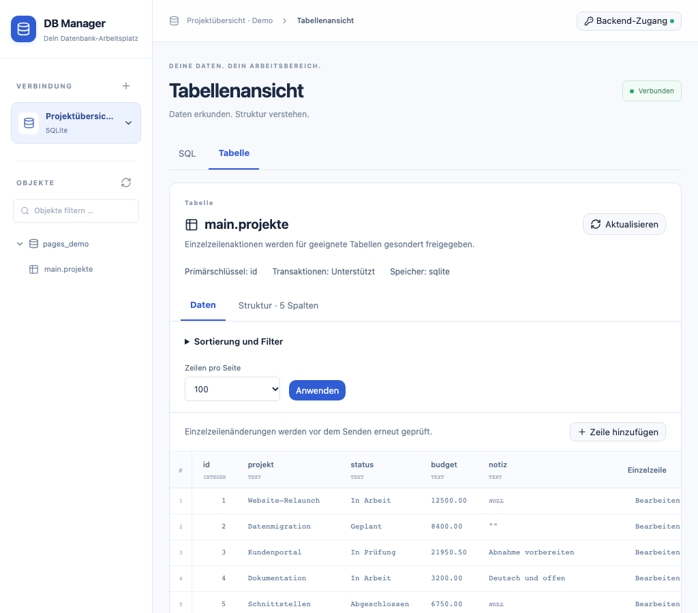

<div align="center">


# DB Manager

**Selbst gehosteter Datenbank-Arbeitsplatz mit Go-Backend, deutscher Weboberfläche und eigenständiger Apple-App.**

[](https://github.com/MagicalWig34653/db-manager/actions/workflows/backend.yml)
[](https://github.com/MagicalWig34653/db-manager/actions/workflows/engine.yml)
[](https://github.com/MagicalWig34653/db-manager/actions/workflows/web-runtime.yml)
[](https://github.com/MagicalWig34653/db-manager/actions/workflows/image.yml)
[](https://github.com/MagicalWig34653/db-manager/actions/workflows/docs.yml)
[](LICENSE)
[](https://github.com/MagicalWig34653/db-manager/pkgs/container/db-manager)

</div>

DB Manager ist ein Datenbankverwaltungswerkzeug im Aufbau. Ein Go-Server liefert API und
eingebettete Weboberfläche aus einem einzigen Container; eine eigene SwiftUI-App für
macOS und iPadOS arbeitet ohne Go-Server. Das Projekt ist **kein fertiges Produkt**: Es
gibt weder einen Release noch vollständige phpMyAdmin-Parität (siehe [Status](#status-und-roadmap)).

## Screenshots

Echte Webscreenshots einer synthetischen SQLite-Wegwerfdatenbank (Herkunft:
[provenance.json](site/assets/screenshots/provenance.json)).

| Tabellenansicht | Einzelzeile bearbeiten |
| --- | --- |
|  |  |
| **SQL-Arbeitsbereich** | **Tablet-Ansicht** |
|  |  |

## Funktionen

Stand laut [docs/STATUS.md](docs/STATUS.md); nur Belegtes ist aufgeführt.

**Go-Server und Weboberfläche**

- Echte Ausführung gegen SQLite, MySQL, MariaDB und PostgreSQL; Netzwerkverbindungen
  standardmäßig mit TLS und Zertifikats-/Hostnamenprüfung.
- Anmeldung per Bearer-Token aus einer Datei. Zugangsdaten der Zieldatenbanken werden nicht
  gespeichert, sondern pro Anfrage übergeben.
- Verbindung, Objektkatalog, Tabellenansicht mit Daten und Struktur, Sortierung,
  gebundene Filter und Pagination.
- Lesende Index- und Constraint-Metadaten sowie bestätigte Anlage neuer Tabellen.
- Bestätigtes Einzelzeilen-Einfügen, -Ändern und -Löschen mit Konflikterkennung.
- Freier SQL-Editor (ein Statement pro Anfrage) mit begrenzten, präzisen Ergebnissen;
  lokaler JSON-/CSV-Download geladener Ergebnisse.
- Deutsche Oberfläche, eingebettet im Go-Programm; Node/npm werden zur Laufzeit nicht benötigt.

**Apple-App** (eigenes Repository): SwiftUI für macOS und iPadOS mit SQLite und direktem
PostgreSQL ohne Go, verifiziertes TLS; Simulator-Builds geprüft, TestFlight-Erstupload
gemeldet.

**Nicht vorhanden oder offen:** vollständige Parität, produktiver Tresor, Sync und Teams,
native MySQL-/MariaDB-Adapter in der App (belegter TLS-Downgrade), Tests auf echten
Geräten, Mehrfachreplikate sowie umfassende Schema-, Import- und Exportfunktionen.

## Schnellstart mit Docker Compose

Voraussetzungen: Docker mit Compose und Python 3 (nur für die Tokenerzeugung).

```sh
git clone https://github.com/MagicalWig34653/db-manager.git
cd db-manager
python3 scripts/create-dev-token.py       # legt secrets/api_token an, ohne es auszugeben
docker compose up --build -d              # baut das Image lokal
docker compose ps
curl --fail http://127.0.0.1:8080/healthz
```

Danach `http://127.0.0.1:8080/` öffnen, unter „Backend-Zugang“ den Inhalt von
`secrets/api_token` einfügen und eine Verbindung anlegen. Compose bindet nur an Loopback;
`DBM_PORT` ändert den lokalen Port. Das Volume `data` bleibt bei `docker compose down`
erhalten, `down --volumes` löscht es.

Das veröffentlichte Image `ghcr.io/magicalwig34653/db-manager` ist Standard in
`compose.yaml`; ob es ohne Anmeldung abrufbar ist, hängt von der Paketsichtbarkeit ab
(Details und Tags: [Betrieb](docs/BETRIEB.md#container-image)). Mit `--build` wird immer
lokal aus dem Checkout gebaut.

Die Compose-Schritte wurden mit einem Wegwerfprojekt auf einem freien Port geprüft:
Container `healthy`, `/healthz` liefert 200, Oberfläche unter `/`.

### Swarm

Einzelreplikat auf einem per Label gewählten Node mit node-lokalem Volume, kein
Hochverfügbarkeitsversprechen:

```sh
docker node update --label-add dbmanager.data=true <data-node>
docker secret create dbmanager_api_token_v1 secrets/api_token
docker stack deploy --compose-file deploy/swarm.yaml dbmanager
```

Swarm veröffentlicht Port 8080 über das Routing Mesh; Netzwerkzugang begrenzen und einen
TLS-Proxy vorschalten. Einzelheiten: [Betrieb](docs/BETRIEB.md#swarm).

## Konfiguration

| Variable | Bedeutung | Standard |
| --- | --- | --- |
| `DBM_TOKEN_FILE` | Pfad der Token-Datei (erforderlich) | Container: `/run/secrets/api_token` |
| `DBM_ADDRESS` | Lauschadresse des Servers | `127.0.0.1:8080`; Container: `0.0.0.0:8080` |
| `DBM_DATA_DIR` | Serverseitiges Datenverzeichnis für SQLite-Dateien | `./data`; Container: `/data` |
| `DBM_ALLOWED_HOSTS` | Kommagetrennte, exakte Hostnamen/IPs erlaubter DB-Ziele | `localhost,127.0.0.1,::1` |
| `DBM_DB_CA_FILE` | Pfad (im Container) zu einem PEM-Bundle zusätzlicher DB-Vertrauenswurzeln | leer |
| `DBM_PORT` | Nur Compose: lokaler Hostport | `8080` |
| `DBM_IMAGE` | Nur Compose/Swarm: Imagename | `ghcr.io/magicalwig34653/db-manager:latest` |
| `DBM_TOKEN_PATH` | Nur Compose: Quelldatei des Token-Secrets | `./secrets/api_token` |
| `DBM_TOKEN_SECRET` | Nur Swarm: Name des externen Secrets | `dbmanager_api_token_v1` |

Externe Datenbanken müssen ausdrücklich über `DBM_ALLOWED_HOSTS` freigegeben werden; der
API-Aufrufer kann die Liste nicht erweitern. Geheimnisse gehören nicht in `.env` oder
Kommandozeilenargumente. Details: [Betrieb](docs/BETRIEB.md).

## Architektur und Repositories

```text
Browser ──HTTP──► Go-Server (API /api/v1, Web-UI /, Healthcheck /healthz) ──► SQLite / MySQL / MariaDB / PostgreSQL
SwiftUI-App ─────────────────── direkt (ohne Go) ───────────────────────────► SQLite / PostgreSQL
```

| Repository | Inhalt |
| --- | --- |
| [db-manager](https://github.com/MagicalWig34653/db-manager) (dieses) | Go-Backend, Container, gemeinsame Dokumentation, API-Verträge, Projekt-Site |
| [db-manager-web](https://github.com/MagicalWig34653/db-manager-web) | Svelte/shadcn-svelte-Weboberfläche (als versionierter Build hier eingebettet) |
| [db-manager-apple](https://github.com/MagicalWig34653/db-manager-apple) | Eigenständige SwiftUI-App für macOS und iPadOS |

Verzeichnisse hier: `cmd/db-manager` (Einstieg), `internal/` (Konfiguration, Kern,
Datenbankadapter, HTTP-API, SQLite-Sandbox, eingebettete Weboberfläche), `contracts/`
(versionierte API-Verträge), `deploy/` (Swarm-Stack), `scripts/` (Prüf- und Hilfsskripte),
`site/` (Landingpage und Doku-Build), `docs/` (Dokumentation). Mehr:
[Architektur](docs/ARCHITEKTUR.md), [Webbuild](docs/WEBBUILD.md).

## Status und Roadmap

Der tatsächliche Stand mit Commits, CI-Nachweisen und Grenzen steht in
[docs/STATUS.md](docs/STATUS.md); geplante Schritte im [Arbeitsplan](docs/ARBEITSPLAN.md),
die Gegenüberstellung von Ziel und Umsetzung in der [Paritätsmatrix](docs/PARITAET.md).
Das Projekt erhebt **keinen Anspruch auf vollständige phpMyAdmin-Parität**. Eine grüne CI
ersetzt keine unabhängige Abnahme.

## Sicherheitshinweise

- Der API-Token gewährt volle SQL-Berechtigung innerhalb der erreichbaren Datenbankkonten:
  nur vertrauenswürdigen Personen geben, Tokendatei nicht veröffentlichen.
- Vor Zugriff über nicht vertrauenswürdige Netze ist ein TLS-Proxy erforderlich; UI und API
  müssen über dieselbe Origin laufen.
- SQL kann Daten verändern; ein Abbruch macht bereits ausgeführte Änderungen nicht rückgängig.
- SQLite verlangt eine Instanz mit exklusivem lokalem Volume (kein WAL, kein NFS, keine HA).
- Die Ausgabegrenzen (vier gleichzeitige Anfragen, 1 MiB je Zelle, 8 MiB je Antwort) ersetzen
  keinen vollständigen Ressourcenschutz; Betreiber begrenzen Ressourcen separat.
- Der Container läuft als UID 10001 mit schreibgeschütztem Root und ohne Capabilities.
- Keine echten Zugangsdaten, produktiven Daten oder SQL-Verläufe in Issues oder Commits.

## Entwicklung

Go ab 1.26 laut `go.mod` (lokal geprüft mit 1.27.1).

```sh
go test -race -count=1 ./...
go vet ./...
go build -o /tmp/db-manager-check ./cmd/db-manager
python3 scripts/check-docs.py
```

Direkter Start ohne Container:

```sh
python3 scripts/create-dev-token.py
DBM_TOKEN_FILE=secrets/api_token go run ./cmd/db-manager
```

Container-, Engine- und Browserintegrationstests (`scripts/test-deployment.py`,
`scripts/test-engine.py`, `scripts/test-web-integration.py`) brauchen Docker und
verwenden nur eigene Wegwerfressourcen; Voraussetzungen und Grenzen stehen in
[EINRICHTUNG.md](EINRICHTUNG.md).

## Mitwirken

Vor Änderungen [CONTRIBUTING.md](CONTRIBUTING.md), [AGENTS.md](AGENTS.md) und den
[Arbeitsplan](docs/ARBEITSPLAN.md) lesen. Größere Änderungen zuerst als abgegrenztes Paket
abstimmen; Code, Tests, Review und Dokumentation gehören zusammen. Dokumentation und
Oberfläche sind Deutsch, Code und technische Bezeichner Englisch. Fehlerberichte nur mit
synthetischen Daten.

## Lizenz

Eigener Projektcode: **AGPL-3.0-only**, Volltext in [LICENSE](LICENSE). Drittanbieter
behalten ihre Lizenzen; Inventar und Originaltexte: [Lizenzen](docs/LIZENZEN.md) und
`licenses/`.

## Dokumentation

- [Dokumentationslandkarte](docs/README.md), [Einrichtung](EINRICHTUNG.md)
- [Betrieb mit Compose und Swarm](docs/BETRIEB.md), [Versionierter Webbuild](docs/WEBBUILD.md)
- [Status](docs/STATUS.md), [Arbeitsplan](docs/ARBEITSPLAN.md), [Projektplan](docs/PROJEKTPLAN.md)
- [Konzept](docs/KONZEPT.md), [Architektur](docs/ARCHITEKTUR.md), [Parität](docs/PARITAET.md)
- [Repositories](docs/REPOSITORIES.md), [Verträge](contracts/README.md)
- [Agents](AGENTS.md), [Claude Code](CLAUDE.md)
