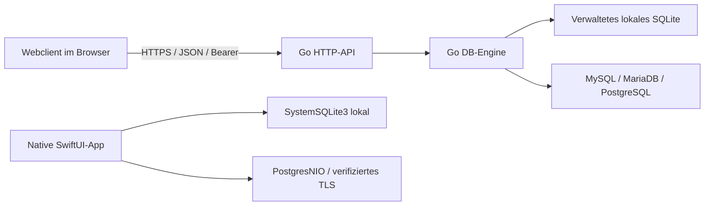

# Architektur

Stand: 20.10.2026. Implementierte Wege und geplante Erweiterungen bleiben getrennt.
Freigegebene Commits/Prüfungen: [STATUS](STATUS.md), Verträge: [Index](../contracts/README.md).

## Implementierte Ausführungswege

Der Go-Teil ist ein modularer Monolith: cmd/db-manager verdrahtet Konfiguration,
HTTP-API, Engine und eingebettete Webassets. internal/core enthält typisierte Werte
und Anwendungsmodelle, internal/httpapi Auth/Validierung/Routen, internal/database
reale Adapter und Metadaten-/Mutationslogik, internal/sqlitesandbox die eingeschränkte
Datei-/Authorizergrenze, internal/webui Originalassets und den festen Dateiwrapper.
Die APIbereiche v1–v4 haben getrennte Fähigkeiten; ältere Vertragsbytes bleiben stabil.
Index-/Constraintmetadaten sind noch ein neuer separater Kandidat.

Das Svelte5-/shadcn-svelte-Webprodukt liegt im eigenen Repo. Buildzeitliche
Standalone-Validatoren erlauben strikte CSP ohne unsafe-eval; exakter öffentlicher
Quellcommit, Lockfile, fünf Assetbytes und Originalnotices werden reproduziert und
mit Manifest in Go eingebettet. Frischer Go-/Containerbau benötigt keinen
Geschwistercheckout; Node/npm sind nur Werkzeuge zur bewussten Asseterneuerung.
Credentials, Token, SQL und Entwürfe verbleiben im flüchtigen Browserzustand.

Die SwiftUI-App ist eigenständig: SystemSQLite3 für ausgewählte lokale Dateien,
PostgresNIO für direkte PostgreSQL-Verbindungen, derselbe native getaggte Ergebniskern.
Sie benötigt keinen Go-Dienst. Netzwerkoperationen öffnen eigene physische Verbindungen,
TLS prüft Host und Zertifikatskette; Zugangsdaten bleiben flüchtig. Konkrete begründete
Abhängigkeitspins und Kalender-/Abbruchregeln stehen im Apple-ADR-A002. Keine native
MySQL-/MariaDB-Freigabe aus den bisherigen Spikes.

## Vertrauens- und Betriebsgrenzen

Ein persönlicher Go-Dienst mit gemeinsamem Bearer-Token, keine Teamkonten oder
Mandantentrennung. Netzwerkziele brauchen administrativ konfigurierte Hostfreigabe,
DNS-/Adressprüfung und passende CA. SQL verwendet tatsächliche DB-Rechte; kein
universeller SQL-Sandboxanspruch. Authentifizierung erfolgt vor Engineaufrufen.
Limits gelten für Request, Zeilen, Rohzelle, tatsächlich encodierte Antwort und Zeit.

Strukturierte Werte sind gebunden, Identifier werden aus validierten Metadaten gequotet.
Einzelzeilenmutationen verwenden konservative Eignung, vollständige erwartete Werte
und DB-Locks/Transaktionen. SQLite REPLACE und PostgreSQL Rewrite sind ausdrücklich
abgesichert. Unbekannter Commitausgang bedeutet keinen automatischen Retry; Trigger-
und externe Effekte/ABA/Exactly-once sind keine universellen Garantien.

Compose und Swarm sind verbindlich (ADR0003). SQLite bleibt gemäß ADR0004 eine
exklusive lokale Datei bei einzelner Replica und einer aktiven Verbindung, DELETE-
Journal, kein WAL/NFS/HA/Powerlossversprechen. Swarm wurde auf eigenem isolierten
DinD-Daemon geprüft, kein belegter Multinode-/HA-Betrieb. Host-Swarm bleibt unberührt.

## Getrennte Folgearbeit

S1 ist ausschließlich ein geprüftes Tresorformat (ADR0005). Der eigenständige native
S2a-Core wird separat entwickelt: kein App-Persistenznachweis, kein produktiver Anchor
allein durch Testprotokoll. Reale Anchor-/Appintegration, Passkeys, verschlüsselter
CloudKit-Sync und Teams benötigen eigene Entscheidungen und praktische Abnahmen.
Geplante weitere Module: Schemaänderung, Import/Export, gespeicherte Abfragen,
Identitäten/Rechte, Freigaben, Jobs und Audit. Der [ursprüngliche Projektplan](PROJEKTPLAN.md)
beschreibt den Zielumfang; vollständige Parität und Geräte-/Distributionsfreigaben
sind noch offen.
